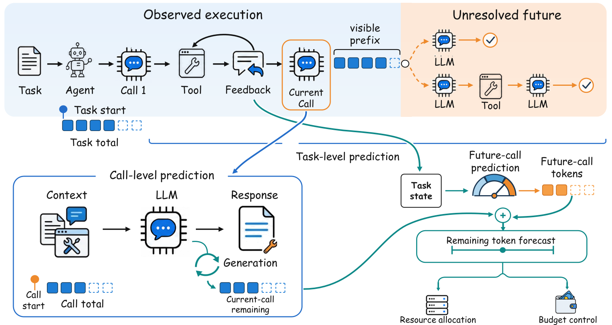

<div align="center">

# TokenCast: Forecasting Token Consumption During LLM Agent Execution
[](https://github.com/DEFENSE-SEU/TokenCast)
[](https://arxiv.org/abs/2609.35760)
[](LICENSE)
[](https://github.com/DEFENSE-SEU/TokenCast/stargazers)

[Chaoqian Ouyang (欧阳超前)*](https://scholar.google.com/citations?hl=zh-CN&user=dJUqJ0oAAAAJ), &nbsp; &nbsp;
[Ling Yue (岳凌)*](https://scholar.google.com/citations?user=EhgyJeYAAAAJ&hl=en), &nbsp; &nbsp;
[Libin Zheng (郑立彬)](https://scholar.google.com/citations?user=_zsllSIAAAAJ&hl=en)✉️, &nbsp; &nbsp;
[Hanghui Guo (郭杭辉)](https://scholar.google.com/citations?user=S34GF9wAAAAJ&hl=en)

[Shengxiang Xu (徐圣翔)](https://scholar.google.com/citations?user=L-uWIQUAAAAJ&hl=en), &nbsp;
[YiShu Wang (汪毅书)](https://scholar.google.com/citations?user=lGqBE5gAAAAJ&hl=en), &nbsp;
[Ran Li (李冉)](https://dblp.org/pid/96/6628.html "DBLP record includes namesakes"), &nbsp;
[Jian Yin (印鉴)](https://dblp.org/pid/95/578-1.html), &nbsp;
[Shaowu Pan (潘韶武)](https://scholar.google.com/citations?user=VOv3F18AAAAJ&hl=en)&nbsp;

[Shimin Di (邸世民)](https://scholar.google.com/citations?user=zLAZJLMAAAAJ&hl=en)✉️

\* *Equal Contribution*
✉️ *Corresponding Author*

</div>

## Overview

TokenCast forecasts token consumption during LLM agent execution, from individual
model calls to complete tasks. As tool feedback changes the execution path and
context accumulates, it updates forecasts using the evidence available so far.

<p align="center">
  
</p>

The paper introduces a composable segment-cost representation that accounts for
context growth and its repeated input cost in later calls. A staged prefix–suffix
predictor combines direct and compositional forecasts, updating its estimates
without additional LLM calls. The research pipeline covers four prediction
positions: task launch, call start, during generation, and task update.

## Local runtime

The Python API, CLI, MCP tools, and Skill support local LightGBM task-launch
prediction for recorded DSH trajectories and controlled Codex code tasks,
with prediction and measured usage stored locally.

## Installation

TokenCast requires Python 3.11 or later, and the benchmark tasks require 3.12.
All commands are run from the repository root.

```bash
git clone https://github.com/DEFENSE-SEU/TokenCast.git
cd TokenCast
```

Create a virtual environment on Linux or macOS:

```bash
python3 -m venv .venv
source .venv/bin/activate
```

or on Windows PowerShell:

```powershell
py -3.12 -m venv .venv
.\.venv\Scripts\Activate.ps1
```

Install the local runtime:

```bash
python -m pip install ".[runtime,mcp]"
```

Run the included checkpoint on a saved real observation, without an LLM call:

```bash
python examples/codex/run.py
```

## Codex (Skill + MCP)

Install the plugin from the repository root:

```bash
codex plugin marketplace add .
codex plugin add token-prediction@tokencast-local
```

Set your model and database paths, then launch Codex in the activated environment.
On Linux or macOS:

```bash
export TOKEN_PREDICTION_MODEL="$PWD/examples/codex/model/bundle"
export TOKEN_PREDICTION_DATA="$PWD/workspace/usage.sqlite3"
codex
```

On Windows PowerShell:

```powershell
$env:TOKEN_PREDICTION_MODEL = (Resolve-Path examples/codex/model/bundle).Path
$env:TOKEN_PREDICTION_DATA = "$PWD/workspace/usage.sqlite3"
codex
```

In the new chat, invoke $predict-tokens with a supported task pack or observation.
For a new task, review the preview and reply to confirm execution. Arbitrary
projects support collection without prediction; forecasts need a separately validated
checkpoint. Collection defaults to 15 minutes and 500,000 input+output tokens.
The included new-task example requires PowerShell and has been validated on Windows.
The desktop app needs the
same Python environment and path variables at startup.

## Other IDEs (MCP Server)

Replace the paths below with this environment's Python executable, your model
bundle directory, and a writable SQLite file. Use forward slashes on Windows.
Merge the entry into your existing configuration if other servers are present.

### Cursor

Create or update .cursor/mcp.json in your project:

```json
{
  "mcpServers": {
    "tokencast": {
      "type": "stdio",
      "command": "/path/to/python",
      "args": [
        "-m", "token_prediction.mcp",
        "--model", "/path/to/model/bundle",
        "--data", "/path/to/usage.sqlite3"
      ]
    }
  }
}
```

### VS Code + GitHub Copilot

Create or update .vscode/mcp.json in your project:

```json
{
  "servers": {
    "tokencast": {
      "type": "stdio",
      "command": "/path/to/python",
      "args": [
        "-m", "token_prediction.mcp",
        "--model", "/path/to/model/bundle",
        "--data", "/path/to/usage.sqlite3"
      ]
    }
  }
}
```

Integration in Cursor and VS Code is pending client-side validation.

## Available tools

Once configured, ask your agent to check TokenCast's model status first.

| Tool | Purpose |
| --- | --- |
| model_status | Check model readiness and supported inputs. |
| predict_tokens | Predict from an observation object or JSON file and save the result. |
| record_usage | Pair measured usage with a prediction ID. |
| prepare_task | Prepare a forecast or collection-only preview without executing. |
| task_status | Read the forecast, progress and final usage. |
| start_task | Execute the prepared task after your confirmation. |
| cancel_task | Cancel preparation or request interruption. |

New-task execution uses a separate controlled Codex thread. Existing IDE chats
are outside the current prediction scope.

## Experiment on public traces

Train and evaluate LightGBM, a history GRU, and baseline predictors on public
agent trajectories.

Install the experiment dependencies:

```bash
python -m pip install ".[runtime,data,neural]"
```

Download the dataset (works in Bash and PowerShell):

```bash
python -c "
import tomllib
from pathlib import Path
from urllib.request import urlretrieve
source = tomllib.loads(Path('configs/experiments/public_trajectory_validation_v1.toml').read_text(encoding='utf-8'))['source']
destination = Path(source['local_path'])
destination.parent.mkdir(parents=True, exist_ok=True)
urlretrieve(source['url'], destination)
"
```

Run the evaluation:

```bash
python -m scripts.experiments.run_public_trajectory_validation --config configs/experiments/public_trajectory_validation_v1.toml --data workspace/external/public_trajectory_validation/source.parquet --output-dir workspace/results/public-validation
```

## Running on your own traces

### Baseline evaluation

On Linux or macOS:

```bash
tc experiment --config configs/experiments/mvp.toml --inputs workspace/data/canonical/*.jsonl --output workspace/results/baselines
```

On Windows PowerShell:

```powershell
$eventFiles = @(Get-ChildItem workspace/data/canonical -Filter *.jsonl -File | Sort-Object Name | ForEach-Object { $_.FullName })
tc experiment --config configs/experiments/mvp.toml --inputs $eventFiles --output workspace/results/baselines
```

This configuration compares an empirical-quantile predictor and a length-only
predictor at task launch, call start, and task update.

### Outputs

| File | Contents |
| --- | --- |
| run.json | Run settings |
| development_protocol.json | Task groups and data splits |
| metrics.json | Prediction errors and interval coverage |
| predictions.jsonl | Predictions for each evaluation record |
| models/ | Models and calibrators saved for each fold |
| comparisons.json | Comparisons between predictors, when enabled |

Check the exported results:

```bash
python -m scripts.experiments.audit_prediction_export workspace/results/baselines
```

## Four-position experiments

Evaluate predictions at task launch, call start, during generation, and task
update.

Run three split seeds with one fitting seed. On Linux or macOS:

```bash
tc experiment --config configs/experiments/four_position_main_table_v1.toml --inputs workspace/data/dsh/*/ --split-seeds 20260719 20260720 20260721 --fit-seeds 20260719 --output workspace/results/four-position
```

On Windows PowerShell:

```powershell
$captureDirs = @(Get-ChildItem workspace/data/dsh -Directory | Sort-Object Name | ForEach-Object { $_.FullName })
tc experiment --config configs/experiments/four_position_main_table_v1.toml --inputs $captureDirs --split-seeds 20260719 20260720 20260721 --fit-seeds 20260719 --output workspace/results/four-position
```

Build the comparison table:

```bash
python -m scripts.experiments.build_main_table workspace/results/four-position --output workspace/results/four-position-table
```

## Development

Install the development dependencies and run the core tests:

```bash
python -m pip install -e '.[dev]'
python -m pytest -q tests/test_pipeline_prediction.py tests/test_nested_splits.py tests/test_features.py tests/test_prediction_points.py
```

## Citation

If you use TokenCast in your research, please cite:

```bibtex
@article{ouyang2026tokencast,
  title={TokenCast: Forecasting Token Consumption During LLM Agent Execution},
  author={Ouyang, Chaoqian and Yue, Ling and Zheng, Libin and Guo, Hanghui and Xu, Shengxiang and Wang, YiShu and Li, Ran and Yin, Jian and Pan, Shaowu and Di, Shimin},
  journal={arXiv preprint arXiv:2609.35760},
  year={2026}
}
```

## License

Licensed under [AGPL-3.0](LICENSE).
